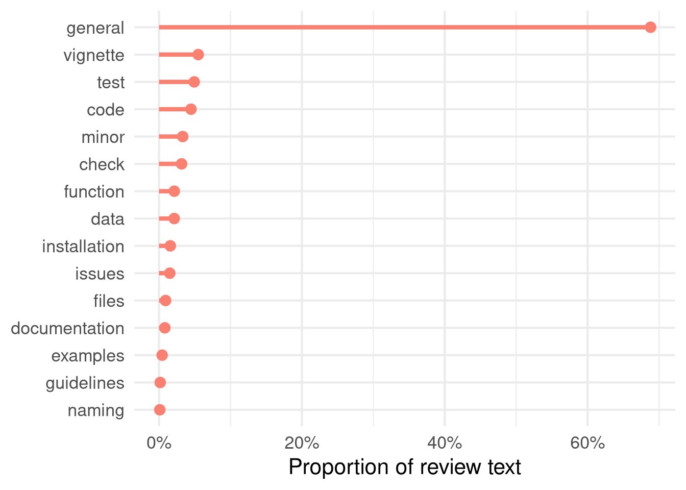
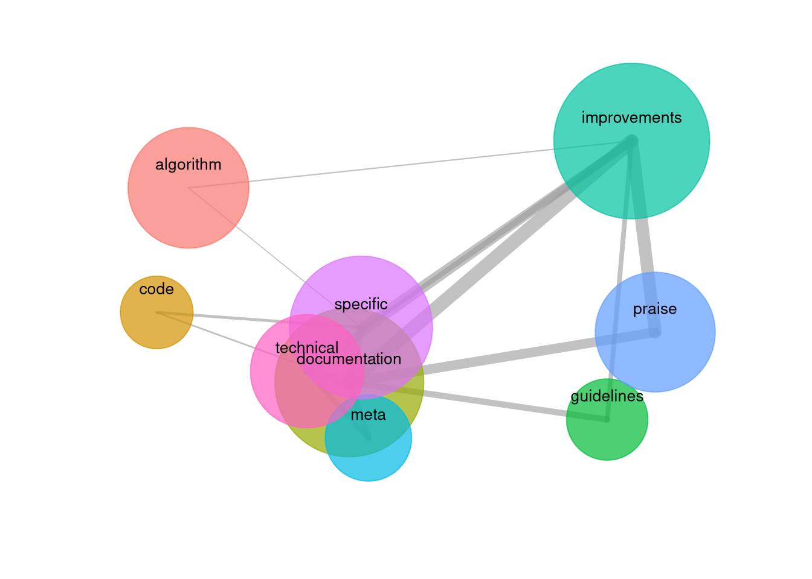
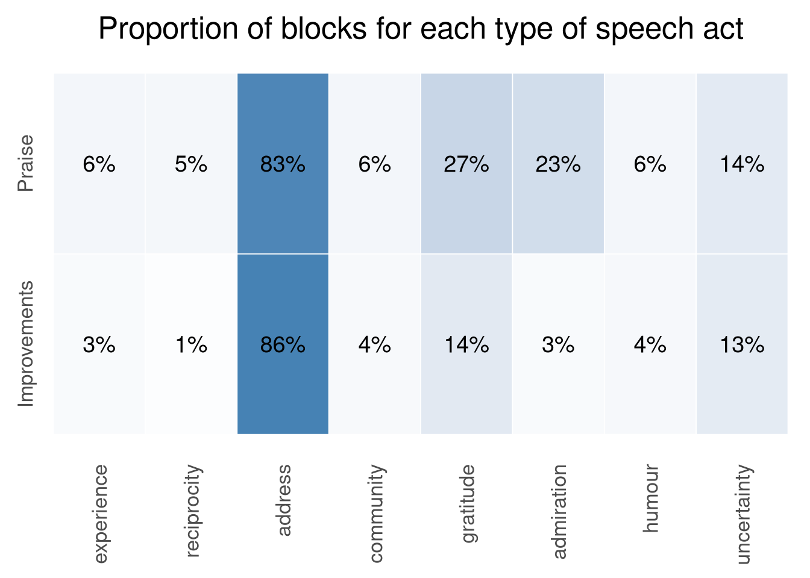

Eight years ago, Maëlle Salmon published an analysis of the [“*Social
weather*” of rOpenSci’s peer review
system](/blog/2018/05/10/onboarding-social-weather/)
(which was called “onboarding” at the time). In an age long before large
language models (LLMs) as we now know them, Maëlle used “old school”
analyses of the texts written by software reviewers to look at term
frequencies, bigrams, and sentiment scores. This blog post updates
Maëlle’s work to take advantage of LLM capabilities for text analysis.
But more pointedly, it has a very specific aim of trying to discern the
truly human aspect of rOpenSci’s software peer review process.

Software review started as a highly manual process in which both editors
and reviewers would laboriously step through processes of installing,
testing, and checking software. Much of this manual work has now been
extensively automated, particularly through our review bot and
[‘pkgcheck’ system](https://docs.ropensci.org/pkgcheck/). And now it is
possible to use LLMs to automate almost all aspects of peer review. The
aim here is to explore what’s left after “*almost*”. If an AI can review
and improve a package as well as human review by rOpenSci, where does
that leave the role of human editors and reviewers? This blog explores
ways of answering that question.

## Data and analysis

These analyses follow the examples set by Maëlle, and examine the
textual content of reviews. I’ll try to avoid technical details (they’re
in [this repo](https://github.com/mpadge/review-issue-analyses), if
you’re interested), with the only necessary background information being
that:

- Input data are the text contents of every review ever posted on
  [github.com/ropensci/software-review/issues](https://github.com/ropensci/software-review/issues)
- Where possible, reviews were passed through [the `md4r`
  package](https://rundel.github.io/md4r/) to convert markdown-formatted
  text into distinct “blocks”, including header and text blocks, where
  each paragraph becomes a distinct block. These blocks form the units
  of analysis.

## Reviews are mostly general

Like Maëlle, I started with document term frequencies, initially for
markdown headings only. All terms were converted to token stems,
frequency tables were constructed, and results converted back to the
most common full words for each token. (Reviews are also conducted in Spanish,
and the term-frequency tables were manually-checked to ensure 

The results gave these 15
categories of review headings, with proportions showing the overall
amounts of review text coming under each of the specified heading
categories.

Although the aesthetic of that plot closely resembles Maëlle’s original,
the results are quite different, and in particular are hugely dominated
by “*general*” comments. All of the other categories are fairly
self-explanatory, and most of them of evidently technical nature. The
*general* parts of each review are clearly likely to be the most “human”
parts, and that’s what I’ll focus on from here on.

From 234 reviews, there were 4,276 of these “*general*” blocks.

## Bring on the LLM analyses

One of the huge advances that LLMs offer for text analyses is the
ability to represent arbitrary texts in terms of [“embedding
vectors”](https://stackoverflow.blog/2023/11/09/an-intuitive-introduction-to-text-embeddings/).
This conversion of text to numeric vectors enables the contextual
similarity of texts to be directly quantified. This in turn means that
large numbers of texts can be grouped or clustered according to
similarity.

Every block (paragraph) of text within all “*general*” review sections
was converted to a 768-dimensional embedding vector (using the
[`nomic-embed-text`
model](https://huggingface.co/nomic-ai/nomic-embed-text-v1.5)), then
re-projected onto an 8-dimensional space with [the `uwot`
package](https://jlmelville.github.io/uwot/reference/umap.html), and
clusters identified with [the `dbscan`
package](https://michael.hahsler.net/dbscan/reference/hdbscan.html).

All texts within each of these clusters were then reduced to a single
descriptive sentence, by passing them to another LLM (this time,
[`mistral`](https://huggingface.co/mistralai/Mistral-7B-Instruct-v0.2)).
The following output shows some examples of the resultant cluster
labels:

    #> # A tibble: 60 × 4
    #>   cluster label                                          n_blocks group     
    #>     <int> <chr>                                             <int> <chr>     
    #> 1      20 Fuzzy Union Operators and Probability                38 algorithm 
    #> 2      21 Testing and Code Practices                           12 technical 
    #> 3      22 Code Compliance & Improvements                       14 technical 
    #> 4      23 Package Review for rOpenSci Guidelines               63 guidelines
    #> 5      25 Contribution Guidelines and Naming Conventions       30 guidelines
    #> # ℹ 55 more rows

That table shows an additional “group” column. Those values were
manually derived by reading the summary labels, and examining additional
context from all block texts where necessary. The following table shows
the distribution of “group” values, noting that,

- The “specific” group contained comments that were specific to the
  package being reviewed
- The “meta” group includes comments about aspects like citations and
  `codemeta` files.
- Text in the “guidelines” group refers to the [rOpenSci
  guidelines](https://devguide.ropensci.org) for software review and
  package development.

<!-- -->

    #> # A tibble: 9 × 2
    #>   group             n
    #>   <chr>         <int>
    #> 1 specific         11
    #> 2 documentation     8
    #> 3 improvements      8
    #> 4 technical         8
    #> 5 meta              7
    #> 6 algorithm         6
    #> 7 praise            6
    #> 8 code              4
    #> 9 guidelines        2

These manually-labelled “groups” then used to examine the structure of
review text in the “*general*” category. In the following plot, groups
are scaled by total numbers of blocks, with links between each pair of
groups scaled according to total proportions of blocks sharing that pair
of groups. Distances between groups are the median cosine distances
between the embedding vectors associated with each pair of groups. So
more semantically similar groups are closer together, and connections
between pairs of groups reflect co-occurrence frequencies.

The central region represents technical and package-specific comments,
including documentation, with more isolated “algorithm” and “code”
groups lying further to the left. The strongest connections are with the
groups on the right of the figure, representing suggestions for
improving packages, and general praise. These are some examples for the
“improvements” category:

    #> # A tibble: 346 × 4
    #>   header_text                  block_text                       categories group
    #>   <chr>                        <chr>                            <chr>      <chr>
    #> 1 Review Comments              Possibilities for improvement    general    impr…
    #> 2 Review Comments              I do have some suggestions for … general    impr…
    #> 3 Final approval (post-review) I also note at the bottom a few… general    impr…
    #> 4 Package man page             The package should ideally have… general    impr…
    #> 5 Review Comments              These comments are more a quest… general    impr…
    #> # ℹ 341 more rows

And these for the “praise” category:

    #> # A tibble: 204 × 4
    #>   header_text      block_text                                   categories group
    #>   <chr>            <chr>                                        <chr>      <chr>
    #> 1 Review Comments  Overall, this package is well designed and … general    prai…
    #> 2 Review Comments  This is a useful R package that is well wri… general    prai…
    #> 3 Review Comments  This package provides R users with a collec… general    prai…
    #> 4 Review Comments  I'm very impressed by the code in the packa… general    prai…
    #> 5 General Comments This is an excellent wrapper for the R univ… general    prai…
    #> # ℹ 199 more rows

## How does constructive human feedback function?

I then wanted to further explore what these “praise” and “improvement”
groups within general review comments actually do. How are they
structured? And what are their linguistic functions? To do this, I
constructed a set of “speech acts”, and again tasked an LLM to tag each
block as representing one or more of those acts. The following acts were
defined:

- `experience`: Personal experience or self-disclosure by the reviewer
  (one-sided);
- `reciprocity`: The reviewer says they learned something, or offers
  further help (two-sided);
- `address`: The reviewer speaks directly to the author about their own
  effort or choices
  - “*You have clearly put a lot of work into this*”
  - “*Your implementation of \<X\> is useful.*”
- `community`: Reference to rOpenSci norms, the editor, other reviewers
  or earlier reviews;
- `gratitude`: Thanks;
- `admiration`: Admiration or delight beyond neutral approval;
- `humour`: Humour, informality, exclamation or emoji; and
- `uncertainty`: Hedged or softened statements; expressions of
  uncertainty.
  - “*I may be misunderstanding here …*”
  - “*You might like to consider doing \<something\> …*”

The following figure illustrates the proportions of all blocks in the
two groups of “improvements” and “praise”.

The two groups only really differ through “praise” containing statements
of *admiration*, and considerably more expressions of *gratitude*. All
other proportions were very similar between the two groups. And of
course the overwhelmingly dominant speech act defining all of these
statements was *address*, or reviewers actively directing and addressing
statements to package authors.

### A tentative model for human software review

The above figure suggests these three conclusions about the nature of
software review:

- The dominance of *address* clearly reveals that review has always
  focussed on software *authors* themselves, well above and beyond the
  software they have developed and submitted for review.
- The second dominant component reflects statements of *gratitude* and
  *admiration*.
- And the third component is the presence of uncertainty, through hedged
  or conditional statements.

These can be reformulated into the following “principles” which appear
to have guided and defined the cultural practices that have been
software review over the past 15 years:

- Software review is about *authors* and their intentions, not just
  their software.
- Software review is *gracious* and *constructive*.
- As an iterative process, software review is *tentative* and open.

------------------------------------------------------------------------

## The future of software review in an age of AI

These analyses have focussed on text blocks with “*general*”-category
headers, and subsequently on the “*improvements*” and “*praise*” groups
within that category. The following table summarises relative
proportions represented by the “*general*” category, and the sub-groups
within that category, in terms both of numbers of “blocks” or
paragraphs, and overall lengths of text (as tokens).

| Category | General-category groups | Prop. blocks | Prop. text |
|----------|-------------------------|--------------|------------|
| General  | All                     | 32.3%        | 39.7%      |
| General  | Impr. + Praise          | 18.8%        | 14.9%      |
| All      | Impr. + Praise          | 6.1%         | 5.9%       |

Those portions of reviews in which these genuinely “human” aspects shine
through amount to only around 6% of all review text ever written.

I said at the start that I wanted to explore what’s left after LLMs have
automated *almost* all aspects of software review. And we can now say
that *almost* all equates to approximately 94%. The true human value
lies in what remains, in the bits that are truly written as
inter-personal statements from one person to another (the “*address*”
group), and that show gratitude and admiration. Grounded in and reflecting
the full context of the review process.

Attention may be all you need[^1], but human attention really is a
unique and special thing. We are uniquely attuned to inter-personal
statements of praise (and of criticism). Amidst a 1,000 word review,
nobody would fail to pay attention to anybody claiming, “*You’re
great!*”. Two words can convey as much meaning as the remaining 998.

I’ll argue in a moment that software review very likely should change
and adapt in the face of AI. But the aspects revealed here that have
always made software review genuinely human can and should remain and be
sustained in much the same ways they always have been. The rest of this
blog explores the remaining bits that will likely need to evolve and
adapt.

### What can AI do?

I wrote at the start that,

> it is possible to use LLMs to automate almost all aspects of peer
> review.

Our [*Dev Guide*](https://devguide.ropensci.org) provides a solid
template for use by LLMs to aid and align package development with
rOpenSci’s expected standards. The [statistical
standards](https://stats-devguide.ropensci.org/) in particular were
written from the outset to be ideally adapted to LLM-based tasks, and
will likely soon be able to be automatically inserted and assessed by
[our ‘ropensci-skills’
package](https://github.com/ropensci-review-tools/ropensci-skills).

Almost all technical aspects can likely be largely automated, including
everything represented here by all categories other than “*general*”,
and even by all manually-labelled groups within that category other than
“*improvements*” and “*praise*”.

In short: An AI can do most of the technical development of your package
for you. You no longer need software peer review to help with that.

### What can AI not do?

Obviously AI can not automate the constructive, inter-personal aspects
of software peer review. And these are hugely important, because
rOpenSci is first and foremost a community of practice and a community
of expertise. The glue of our community emerges from constructive,
inter-personal relationships, many of which are first forged during peer
review.

A more pragmatic version of this question is then what software peer
review should become when most of what it has been can now be largely
automated. The substance of peer review clearly needs to move away from
aspects that can be easily automated, while still leaving the entire
system open for software authors who eschew any use of AI. What can or
should review then focus on?

Just as computer programming has evolved through what can be considered
increasing [layers of
abstraction](https://en.wikipedia.org/wiki/Abstraction_layer), from
assembly to low-level compiled languages to higher-level scripted
languages like R, AI now represents – or forces – another increase in
abstraction away from code itself. AI can not generate ideas; those come
from humans who use these systems. All computer programs are
transcriptions in encoded form of underlying or originating human ideas.

The current challenge for software review is that those ideas are no
longer necessarily manifest in the code itself. The [*Journal of Open
Source Software (JOSS)*](https://joss.theoj.org/) now requires
additional documentation describing the [research impact and
design](https://joss.readthedocs.io/en/latest/submitting.html#scope-and-significance)
of software. These requirements quickly evolved into general practices
for JOSS authors of providing extensive descriptions in the required
“paper.md” document. (Click on any “Recently Published Papers” on the
[main site](https://joss.theoj.org/) to see examples.)

These are the bits that AI can not do; the high-level contextual
positioning and intention of software. The awareness of the general
field within software is positioned, and the importance and implications
of the problems it attempts to solve, or the advances it represents.

### The evolving focus of software peer review

The focus of software review will need to evolve away from code alone,
and towards “higher level” records of human design intentions and
decisions. I think this will require extending beyond JOSS’s example, in
particular to formalise guidelines or structures for how these kind of
higher-level design decisions are recorded within the software itself.

JOSS also requires a minimal six months of public development history,
and I suspect a requirement like that may also be necessary for
rOpenSci. Software design has always been an iterative process, and
sufficiently extensive development logs provide some of the best evidence of
that process.

I would like to see bold examples of largely AI-generated software being
submitted for peer review, but in ways that include structured
documentation of all design decisions that have guided software
evolution. A community of practice like rOpenSci should lead by example, and
those examples should come from our community. Help shape our future by
thinking about the issues raised here, and working with us to help the ongoing
evolution of software peer review.

[^1]: No, I’m not going to provide yet another citation for that paper.
    Look it up if you really want to.
