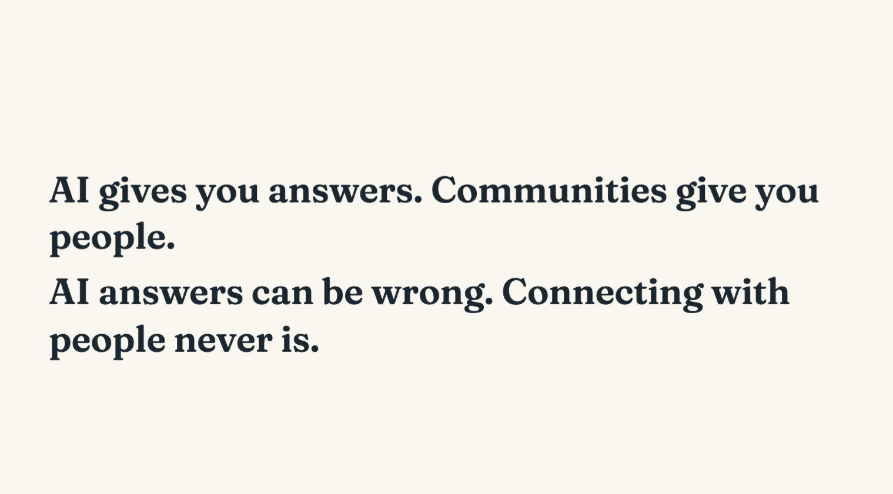

On October 1, 2026 Openscapes hosted a Community Call on Open Communities in the Age of AI. The 1.5-hour event included four speakers, a panel discussion, and questions from participants. Among more than sixty participants, we recognized so many we connect with regularly across our communities\! This post synthesizes some themes that we hope will entice you to watch the recording and consider how you intentionally welcome people into the communities you value.

## The call

It has been just over a month since Openscapes hosted the [Community Call: Open Communities in the age of AI](https://openscapes.org/events/2026-10-01-community-call-open-communities-ai/). Why the long delay in this post? Because it was something *really* good. So good, in fact, that I (Mara) was reticent to recap it—not wanting to diminish what was said. However, the video and notes are available on the call page, so here is a synthesis, not of what was said, but where we (the four panelists) converged. The topic, as Openscapes described it, had a very specific aim:

::: {.blockquote-blue}
> “We want to talk about the impact of AI on the growth and maintenance of communities, and the people in those communities. There are discussions happening in many Open Source communities about how to manage and use AI effectively and responsibly \- discussions about increased burden on maintainers, policies for AI-written PRs, etc. Those are important conversations, however, **the conversations about impacts of AI on communities are rare**.”[^1]
:::

## How events like this happen

As it so happens, the event itself was a meta example of one solution to themes and challenges we identified. Which means it took work.

This community call did not organize itself. What began as a [GitHub issue](https://github.com/Openscapes/how_we_work/issues/475) opened by Stefanie Butland in May, inspired by an idea from Andy Teucher, became a discussion, an opportunity to connect, and eventually an invitation to speakers and the community to participate in a conversation. The passive “*became*” in the previous sentence hides the work of others—Julie Lowndes, Ronny Hernández Mora, Ileana Fenwick—who facilitated and “co-produced” this event. In a time when more and more of us work alone (Mark Padgham's numbers on that to come), the call itself captured much of what the speakers identified as important: intentionality, using tools to facilitate connection, reaching out to one another for the things AI tools can't provide.

The impetus for the discussion was not just a product of a few folks noticing and wanting to hear one another's perspectives on AI and open-source communities. It's definitionally a part of what Openscapes actually *is*. As Stefanie described in the opening:

::: {.blockquote-blue}
> “Openscapes is an **open-source approach and a movement**. It's a mechanism that helps research teams **find each other** and feel empowered with modern data-intensive science workflows.”
:::

Andy continued:

::: {.blockquote-blue}
> “…open communities have a culture of shared and continued learning, and they prioritize diversity, equity, and belonging. They help us **connect with each other on a human level around the things that we're passionate about**.”
:::

It's because of communities like these that the organizers and panelists can see and feel an absence, a change—not something necessarily born of the use of AI-tools, but amplified and accelerated by them in a way that's palpable. *But*, we convened neither to mourn, nor to wax nostalgic about days of yore that were imperfect, but to put to practice the kind of collaboration we've used to build and maintain software for years—this time, on open-source communities themselves.

Hadley, Mark, Yanina and I have different lived experiences. That's *why* we came together. As Mark posited in [Coding Alone](https://mpadge.eu/blog/coding-alone.html): “Maybe software coded by increasingly isolated individuals will be just as good as previous software coded by larger communities building on one another’s ideas.”[^2] The same cannot be said of communities, especially not ones built around a “knowledge commons.”[^3] Communities sustain shared resources through self-organized collective action—co-production, *by definition*, cannot occur alone.[^4]

The [video and notes](https://openscapes.org/events/2026-10-01-community-call-open-communities-ai/) are archived for you to peruse in full, but here I capture some themes and takeaways that stood out.

## The four-way convergence

From our different vantage points, and in our own words, we converged around one idea: ***what used to be incidental now has to be deliberate*****.** Some of the friction that’s been removed by using AI tools had side effects that we didn’t know we were counting on—much of it related to community. And so, now, the challenge becomes one of creating conditions for encounters that used to just happen as byproducts of need.

### It was never just about need \- Mara Averick

- My “tripped-into-open-source” story leaves out the people who *invited* me in. I don't think I could do it today, because so much of what happened *around* me isn't happening anymore.  
- Asking in public got you unstuck, but it also taught the answerer, revealed new experts, built a shared vocabulary, and made people visible.[^5]  
- Nobody took the side-effects of asking in public away on purpose—the learning done by a person one rung ahead, the visibility of the asker to other community members, the abstraction born of common vocabulary—they were bundled with the need to ask.  
- A default isn't a fate. **Invitation used to be a byproduct of asking for help; now it has to be built.**

### The long view \- Hadley Wickham

- Over his \~20 years in the R community, Hadley has moved with it from the r-help mailing list to Stack Overflow, `#rstats` Twitter and Bluesky. Each new place was a chance to ask what we value and carry that forward.  
- Some of what's worth carrying was incidental. Places like Twitter (used to) let people bring their whole selves, so you'd meet someone over R (or crochet) and discover everything else interesting about them.  
- Losing a place you love is scary, but it's also a chance to ask “what can we do better this round?”  
- [Tidyverse developer days](https://tidyverse.org/tags/tidyverse-dev-day/) for the contributor community make the incidental deliberate. AI use is welcome, but **fixing issues has never been the point. “We're doing this because we want to build that community.”**

### Now with numbers \- Mark Padgham

Mark Padgham came bearing data, paired with deep philosophical consideration. His piece, [Purposeful Joy](https://mpadge.eu/blog/purposeful-joy.html), which aims to “to help computer programs replace the purposeful labour of a generation of uniquely idiosyncratic human beings”[^6] helped shape this call. And many of the findings from his presentation are captured beautifully in prose in [Coding Alone](https://mpadge.eu/blog/coding-alone.html).

- Working alone was on the rise before AI tools entered the picture. Across npm, PyPI, CRAN, JOSS and rOpenSci, the share of repositories effectively maintained by one person has gone from 27% in January 2021 to 44% in October 2026.[^7] AI tools have sped that up; they didn't start it.  
- This isn't inevitable. AI tools “reflect conscious design decisions on the part of humans”, which means they can be designed differently.  
- [`askfirst`](https://github.com/mpadge/askfirst)[^8] is one example. When your coding agent hits something a package can't do, instead of quietly building its own workaround, `askfirst` prompts the agent to connect you to the packages’ authors. In Mark's words, it's **“nothing but an invitation.”**

### What communities give that AI cannot \- Yanina Bellini Saibene

Yani told three stories, each an offering with a lesson for community managers and one for community members. They're well worth watching in full.

- The value of communities is moving “from information to judgment and trust”—knowing who is there, and trusting them enough to build something together.  
- Asking for help used to be an incidental on-ramp to such communities, but it's weakening. So **we need to build on-ramps that *don't* depend on someone being stuck.**  
- Rethink how we welcome people. Every interaction you have with a colleague is a chance to be open. Part of the welcome is saying “You CAN”.  
- “AI gives you answers. Communities give you people. AI answers can be wrong. Connecting with people never is.”

## Closer

The discussion that followed is well worth watching, and I encourage you to do so. There is, however, one quotation from Yanina that captured the essence of the call so beautifully that I simply must include it here:

::: {.blockquote-blue}
> “***The community is not only a place to get unstuck, it is a place that will help you grow.*** Beyond the immediate tasks that you need to do. So, it is the contact network. So, why are we all here, all the speakers today? Because we have our contact network in some places, ***we know each other, and we know our work, and we trust each other*****.** So, you will not get that from the model, how you co-create something with someone. You are not going to get that with the model.” — Yanina Bellini Saibene  
:::

>   
::: {style="text-align:center;"}
{fig-alt="black text on two lines says, AI gives you answers. Communities give you people. AI answers can be wrong. Connecting with people never is." fig-align="center" width="60%"}
:::

## Resources

* [*Recording*](https://youtu.be/tc3oj8UEAPQ)  
* [*Notes doc*](https://docs.google.com/document/d/16xDtQnUcZl70_0NhiV5L7OQ5om3dpyXMz6mNiBp-5W4/)  
* *Speakers*  
  * [*Mara Averick*](https://www.linkedin.com/in/maraaverick/)*, Senior Developer Advocate at [Quansight](https://quansight.com/) and Contributor-Experience Lead for [stdlib](https://stdlib.io/) ([blog](https://blog.stdlib.io/tag/developer-relations/)) ([slides](https://docs.google.com/presentation/d/1Dl5YJy6ROykFbLRm38Wu6IKi9Q3M9--6ZTMUZ7Z0ciU/edit?slide=id.p1#slide=id.p1))*  
  * [*Hadley Wickham*](https://hadley.nz/)*, Chief Scientist at [Posit](https://posit.co/) ([slides](https://drive.google.com/file/d/1Jj8LEeB7RLncDs-nqn54tPEJY2dKNESM/view?usp=drive_link))*  
  * [*Mark Padgham*](https://mpadge.eu/blog/)*, Software Review Lead at [rOpenSci](https://ropensci.org/) ([slides](https://mpadge.github.io/presentations/2026/openscapes/))*  
  * [*Yanina Bellini Saibene*](https://yabellini.netlify.app/)*, Community Manager at [rOpenSci](https://ropensci.org/), [Sovereign Tech Fellow 2026](https://www.sovereign.tech/programs/fellowship). Member of [RLadies+](https://rladies.org/) and [The Carpentries](https://carpentries.org/) Board of Directors  ([slides](https://yabellini.github.io/OpenScapes/))* 

[^1]: Openscapes. 2026\. “Community Call: Open Communities in the Age of AI.” October 1\. [https\://www\.openscapes.org/events/2026-10-01-community-call-open-communities-ai/](https://www.openscapes.org/events/2026-10-01-community-call-open-communities-ai/).

[^2]: Padgham, Mark. 2026\. “Coding Alone.” mpadge, October 12\. [https\://mpadge.eu/blog/coding-alone.html](https://mpadge.eu/blog/coding-alone.html).

[^3]: Hess, Charlotte, and Elinor Ostrom, eds. 2007\. Understanding Knowledge as a Commons: From Theory to Practice. MIT Press.

[^4]: Ostrom, Elinor. 1990\. Governing the Commons: The Evolution of Institutions for Collective Action. Cambridge University Press.

[^5]: Averick, Mara. 2026\. “What We're No Longer Seeing: AI and the Invisible Newcomer in Open Source.” Numerical Bits, June 7\. [https\://blog.stdlib.io/ai-and-the-invisible-newcomer-in-open-source/](https://blog.stdlib.io/ai-and-the-invisible-newcomer-in-open-source/)

[^6]: Padgham, Mark. 2026\. “Purposeful Joy.” mpadge, June 26\. [https\://mpadge.eu/blog/purposeful-joy.html](https://mpadge.eu/blog/purposeful-joy.html).

[^7]: Padgham, Mark. 2026\. “Coding Alone.” mpadge, October 12\. [https\://mpadge.eu/blog/coding-alone.html](https://mpadge.eu/blog/coding-alone.html).

[^8]:  Padgham, Mark. 2026\. askfirst: Connect AI with Your Coding Communities. [https\://github.com/mpadge/askfirst](https://github.com/mpadge/askfirst).